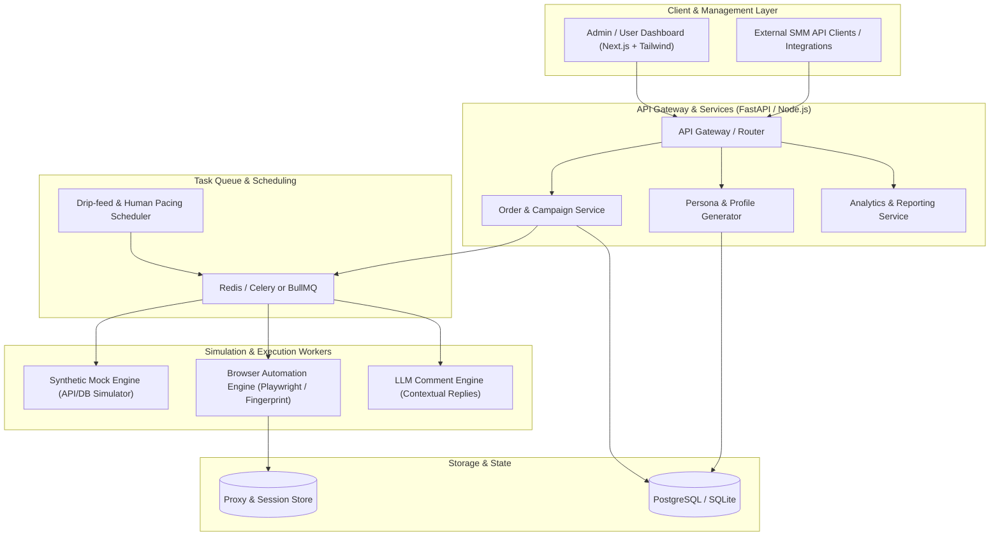
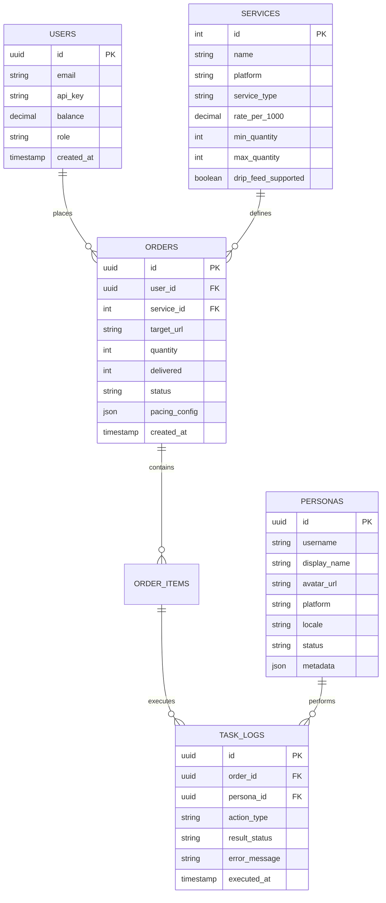
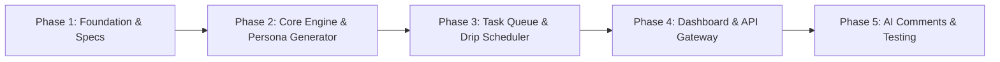

# Project Plan: Dummy Social Media Engagement Engine (Bot Buddy)

## 1. Project Overview & Vision

**Bot Buddy** is a modular social media simulation and dummy engagement engine. The system is designed to simulate realistic social media interactions—including dummy followers, views, likes, reactions, and intelligent comments—for platforms such as Facebook, Instagram, and YouTube.

### Core Objectives
- **Synthetic Engagement Simulation**: Provide realistic drip-fed and instant engagement metrics (likes, reactions, views, comments, followers).
- **Realistic Persona Engine**: Generate and manage authentic-looking bot personas with localized names, realistic profile bios, profile pictures, and behavior patterns.
- **Drip-Feed & Pacing Control**: Avoid unrealistic spikes by simulating natural human behavior (stochastic delays, active hours, retention curves).
- **Flexible Modes**: Support both **Pure Synthetic Mode** (for mocking APIs, testing analytics platforms, and stress testing) and **Browser Automation Mode** (via headless browsers like Playwright for actual web simulation).
- **Standardized API**: Compatible with SMM panel APIs (Standard API v2) and custom REST/GraphQL endpoints.

---

## 2. System Architecture

---

## 3. Core Modules & Specifications

### 3.1 Persona & Account Engine
- **Profile Generation**:
  - Realistic localized names (e.g., US, UK, South Asian, European demographics).
  - High-quality AI-generated or curated avatar profiles.
  - Contextual bios and account history simulation.
- **Account State Machine**:
  - Statuses: `Available`, `Active`, `Cooling Down`, `Restricted`, `Retired`.
  - Activity logs per persona (ensures an account doesn't like the same post twice or post conflicting sentiments).

### 3.2 Engagement Service Modules
| Service Type | Actions / Variations | Delivery Modes | Pacing Mechanics |
| :--- | :--- | :--- | :--- |
| **Reactions / Likes** | Standard Like, Love, Care, Haha, Wow, Sad, Angry | Instant / Drip-feed | Randomized time intervals (e.g., 5s - 45s between reactions) |
| **Comments** | Custom text, Spintax (`{Great\|Awesome\|Nice} post!`), AI Contextual | Linear / Bursts | Sentiment matching, typo simulation, realistic lengths |
| **Followers / Page Likes** | Profile followers, Page followers, Group members | Daily drip, Scheduled batches | Retention curve simulation (optional natural drop-off test) |
| **Views & Watch Time** | Video views, Reel/Short views, Story views | Continuous stream | Retention duration simulation (e.g., 30s, 60s, 100% completion) |
| **Shares / Saves** | Wall shares, Group shares, Direct saves | Scheduled intervals | Distributed source attribution |

### 3.3 Natural Drip-Feed & Anti-Detection System
- **Human Behavior Emulation**:
  - Gaussian distribution for reaction delays.
  - Peak hour scheduling (simulates daytime traffic vs night lull).
  - Cursor movement jitter, natural scroll delays (for browser automation mode).
- **Proxy & IP Rotation**:
  - Residential & Datacenter proxy support.
  - Sticky session management per persona.

### 3.4 AI-Powered Smart Comments Engine
- LLM prompt integration (OpenAI / Claude / Local LLM) to analyze post caption/context and produce:
  - Positive / Supportive comments.
  - Question-based engaging comments.
  - Emoji-heavy casual social comments.
  - Custom topic focus (e.g., crypto, tech, fashion, gaming).

---

## 4. Database Schema Design (High-Level)

---

## 5. Technology Stack Selection

- **Backend Framework**:
  - **Python (FastAPI)**: Recommended for rich async task processing, AI integrations, and automation tools (Playwright Python).
  - *Alternative*: **Node.js (TypeScript / NestJS)** with BullMQ.
- **Database**:
  - **PostgreSQL**: Robust relational storage for orders, users, services, and persona states.
  - **Redis**: High-speed task queue and rate-limiting store.
- **Frontend / Dashboard**:
  - **Next.js (App Router, React 19)** + **Tailwind CSS** + **shadcn/ui**: Modern, clean dashboard for ordering, live log streaming, and metric graphs.
- **Task & Worker Engine**:
  - **Celery** or **ARQ / RQ** (Python) / **BullMQ** (Node.js).
- **Automation / Scraping**:
  - **Playwright** with stealth plugins (for realistic browser sessions).

---

## 6. Project Roadmap & Milestones

### Phase 1: Foundation & Architecture (Current)
- [x] Project plan & architectural documentation.
- [ ] Technology stack selection and boilerplate repository setup.
- [ ] Database schema definition and migration setup.

### Phase 2: Persona Generator & Synthetic Engine
- [ ] Mock persona generation engine (names, photos, bios, locales).
- [ ] Core interaction handlers:
  - Like / Reaction handler.
  - Comment generator (Spintax + custom presets).
  - Follower & View simulation counter.

### Phase 3: Queue Management & Drip-Feed Scheduler
- [ ] Worker pipeline setup with Redis queue.
- [ ] Natural timing algorithms (delays, burst control, drip scheduling).
- [ ] Failure recovery & retry logic.

### Phase 4: Management Dashboard & API
- [ ] Standard SMM Panel API v2 compatible endpoints (`add`, `status`, `services`, `balance`).
- [ ] Interactive Dashboard UI:
  - Order creation form with custom target URL and pacing.
  - Live progress tracker (Delivered vs Remaining).
  - Persona management table.

### Phase 5: AI Contextual Comments & Browser Automation
- [ ] LLM-based post context extraction & dynamic comment generator.
- [ ] Optional headless Playwright driver for real target interaction experiments.
- [ ] Comprehensive unit, integration, and load testing.

---

## 7. Standard API v2 Specification (SMM Integration Ready)

To easily connect with industry standard panels and automation scripts:

- **`POST /api/v2`** with parameters:
  - `action=services`: List all available dummy services (Likes, Followers, Views, Comments).
  - `action=add`: Submit a new dummy engagement order (`service`, `link`, `quantity`, `comments`, `runs`, `interval`).
  - `action=status`: Retrieve status, start counter, and delivered count.
  - `action=balance`: Check account mock balance.

---

## 8. Disclaimer & Ethical Guidelines

> [!WARNING]
> This software is intended solely for **educational, testing, simulation, and software development purposes** (such as load testing social analytics tools, UI prototyping, and stress testing platforms).
> Any use violating terms of service of third-party platforms (like Meta / Facebook Terms of Service) is strictly the responsibility of the operator.
